# Danh mục 18 tầng — nội dung và minh họa

Ngày biên soạn: 02/11/2026. Đọc cùng [nghiên cứu nguồn](RESEARCH.md).

Tên, thứ tự và hình tượng định danh dựa trên S1; diễn giải, thành phần cảnh và câu đố là sáng tác của dự án. Các SVG dưới đây là minh họa gốc, không phải ảnh tư liệu. Mỗi tầng có sân cảnh hình phạt riêng, dùng chung mặt phẳng điều khiển. Model và đạo cụ được vẽ bằng vector, có hoạt cảnh trong game; nhấp sân cảnh để xem mô tả, chưa thao tác riêng từng vật thể.

## 1. Bạt Thiệt — 拔舌


- Hình tượng định danh: Kéo lưỡi.
- Chủ đề trong dị bản tiếng Việt S6: Khẩu nghiệp. Không phải luật phán xét của game.
- Ý nghĩa theo dị bản: Trong bản kể dân gian S6: khẩu nghiệp. Hình tượng: kìm kéo lưỡi.
- Bài học chuyển thể: Suy ngẫm về lời nói và sự thật.
- Cảnh hình phạt: Kìm kéo lưỡi. Quỷ tốt kéo lưỡi vong bằng kìm.
- Thành phần thiết kế: Kìm sắt, Ghế áp giải, Dải lưỡi hoạt hình.
- Câu hỏi tương tác: Một lời đồn chưa được kiểm chứng. Bạn sẽ làm gì?
- Gợi ý đáp án: Kiểm chứng trước khi kể.

## 2. Tiễn Đao — 剪刀


- Hình tượng định danh: Kéo cắt.
- Chủ đề trong dị bản tiếng Việt S6: Quan niệm thủ tiết cũ. Không phải luật phán xét của game.
- Ý nghĩa theo dị bản: Trong bản kể dân gian S6: quan niệm thủ tiết cũ. Hình tượng: kéo cắt ngón.
- Bài học chuyển thể: Suy ngẫm về tổn thương trong các mối quan hệ.
- Cảnh hình phạt: Kéo cắt ngón. Kéo lớn cắt ngón tay trong dị bản.
- Thành phần thiết kế: Kéo lớn, Bàn hình phạt, Bàn tay bóng vong.
- Câu hỏi tương tác: Hai người hiểu lầm nhau. Bạn chọn cách nào?
- Gợi ý đáp án: Lắng nghe cả hai phía.

## 3. Thiết Thụ — 铁树


- Hình tượng định danh: Cây sắt.
- Chủ đề trong dị bản tiếng Việt S6: Chia rẽ gia đình. Không phải luật phán xét của game.
- Ý nghĩa theo dị bản: Trong bản kể dân gian S6: chia rẽ gia đình. Hình tượng: treo trên cây sắt.
- Bài học chuyển thể: Suy ngẫm về những hành động gây chia rẽ.
- Cảnh hình phạt: Treo trên cây sắt. Vong bị treo lên cây có lưỡi nhọn.
- Thành phần thiết kế: Cây sắt, Cành lưỡi đao, Móc treo.
- Câu hỏi tương tác: Lối đi bị rễ cây chia cắt. Bạn làm gì?
- Gợi ý đáp án: Cùng tìm một lối an toàn.

## 4. Nghiệt Kính — 孽镜

- Hình tượng định danh: Gương soi nghiệp.
- Chủ đề trong dị bản tiếng Việt S6: Soi tội trạng. Không phải luật phán xét của game.
- Ý nghĩa theo dị bản: Trong bản kể dân gian S6: soi tội trạng. Hình tượng: gương soi nghiệp.
- Bài học chuyển thể: Suy ngẫm về việc nhìn nhận hành động của mình.
- Cảnh hình phạt: Gương soi nghiệp. Gương hiện việc đã làm; đây là cảnh xét nghiệp.
- Thành phần thiết kế: Gương đồng, Bệ soi, Sổ ghi nghiệp.
- Câu hỏi tương tác: Gương hiện lại lỗi lầm của bạn. Bạn chọn gì?
- Gợi ý đáp án: Thừa nhận và sửa sai.

## 5. Chưng Lung — 蒸笼


- Hình tượng định danh: Lồng hấp.
- Chủ đề trong dị bản tiếng Việt S6: Đồn đại hại người. Không phải luật phán xét của game.
- Ý nghĩa theo dị bản: Trong bản kể dân gian S6: đồn đại hại người. Hình tượng: lồng hấp.
- Bài học chuyển thể: Suy ngẫm về điều bị che giấu sau vẻ ngoài.
- Cảnh hình phạt: Lồng hấp. Vong bị nhốt trong lồng hấp nóng.
- Thành phần thiết kế: Lồng tre nhiều tầng, Bếp lò, Ống hơi.
- Câu hỏi tương tác: Hơi nước che một người lạc đường. Bạn sẽ?
- Gợi ý đáp án: Dừng lại dẫn họ qua.

## 6. Đồng Trụ — 铜柱


- Hình tượng định danh: Cột đồng nung.
- Chủ đề trong dị bản tiếng Việt S6: Phóng hỏa. Không phải luật phán xét của game.
- Ý nghĩa theo dị bản: Trong bản kể dân gian S6: phóng hỏa. Hình tượng: ôm cột đồng nung.
- Bài học chuyển thể: Suy ngẫm về trách nhiệm và sự kiềm chế.
- Cảnh hình phạt: Ôm cột đồng nung. Vong phải ôm cột đồng nóng đỏ.
- Thành phần thiết kế: Cột đồng, Than nóng, Quạt lò.
- Câu hỏi tương tác: Một cơn giận đang bùng lên. Bạn chọn gì?
- Gợi ý đáp án: Bình tâm rồi đối thoại.

## 7. Đao Sơn — 刀山


- Hình tượng định danh: Núi đao.
- Chủ đề trong dị bản tiếng Việt S6: Sát sinh. Không phải luật phán xét của game.
- Ý nghĩa theo dị bản: Trong bản kể dân gian S6: sát sinh. Hình tượng: leo núi đao.
- Bài học chuyển thể: Suy ngẫm về bạo lực và lòng trắc ẩn.
- Cảnh hình phạt: Leo núi đao. Vong bị buộc vượt núi lưỡi sắc.
- Thành phần thiết kế: Núi đao, Bậc lưỡi kiếm, Cờ chỉ lối.
- Câu hỏi tương tác: Có người mắc kẹt bên sườn núi. Bạn sẽ?
- Gợi ý đáp án: Buộc dây và giúp họ.

## 8. Băng Sơn — 冰山

- Hình tượng định danh: Núi băng.
- Chủ đề trong dị bản tiếng Việt S6: Định kiến và bất nghĩa. Không phải luật phán xét của game.
- Ý nghĩa theo dị bản: Trong bản kể dân gian S6: định kiến và bất nghĩa. Hình tượng: núi băng giá.
- Bài học chuyển thể: Suy ngẫm về sự lạnh lùng trước nỗi khổ.
- Cảnh hình phạt: Núi băng giá. Vong chịu giá lạnh trên núi băng.
- Thành phần thiết kế: Tháp băng, Hồ băng, Gió tuyết.
- Câu hỏi tương tác: Chỉ còn một bếp lửa. Bạn làm gì?
- Gợi ý đáp án: Chia sẻ hơi ấm.

## 9. Du Oa — 油锅

- Hình tượng định danh: Vạc dầu.
- Chủ đề trong dị bản tiếng Việt S6: Cướp đoạt. Không phải luật phán xét của game.
- Ý nghĩa theo dị bản: Trong bản kể dân gian S6: cướp đoạt. Hình tượng: vạc dầu sôi.
- Bài học chuyển thể: Suy ngẫm về lòng tham và cái giá phải trả.
- Cảnh hình phạt: Vạc dầu sôi. Vong bị thả vào vạc dầu nóng.
- Thành phần thiết kế: Vạc gang, Lò lửa, Muôi sắt.
- Câu hỏi tương tác: Bạn tìm thấy túi đồ của người khác. Bạn sẽ?
- Gợi ý đáp án: Tìm người đánh mất.

## 10. Ngưu Khanh — 牛坑


- Hình tượng định danh: Hố trâu.
- Chủ đề trong dị bản tiếng Việt S6: Hành hạ động vật. Không phải luật phán xét của game.
- Ý nghĩa theo dị bản: Trong bản kể dân gian S6: hành hạ động vật. Hình tượng: trâu húc giẫm.
- Bài học chuyển thể: Suy ngẫm về cách đối xử với sinh linh.
- Cảnh hình phạt: Trâu húc giẫm. Đàn trâu húc, giẫm trong hố.
- Thành phần thiết kế: Hố sâu, Trâu âm phủ, Rào gỗ.
- Câu hỏi tương tác: Một con vật đang khát bên đường. Bạn sẽ?
- Gợi ý đáp án: Cho nó uống nước.

## 11. Thạch Áp — 石压


- Hình tượng định danh: Đá đè.
- Chủ đề trong dị bản tiếng Việt S6: Bỏ rơi trẻ em. Không phải luật phán xét của game.
- Ý nghĩa theo dị bản: Trong bản kể dân gian S6: bỏ rơi trẻ em. Hình tượng: đá lớn đè.
- Bài học chuyển thể: Suy ngẫm về áp lực đặt lên người khác.
- Cảnh hình phạt: Đá lớn đè. Tảng đá thả xuống đè vong.
- Thành phần thiết kế: Đá treo, Dây thừng, Khung tời.
- Câu hỏi tương tác: Bạn đồng hành không nâng nổi tảng đá. Bạn sẽ?
- Gợi ý đáp án: Cùng dùng đòn bẩy.

## 12. Thung Cữu — 舂臼


- Hình tượng định danh: Chày cối.
- Chủ đề trong dị bản tiếng Việt S6: Lãng phí lương thực. Không phải luật phán xét của game.
- Ý nghĩa theo dị bản: Trong bản kể dân gian S6: lãng phí lương thực. Hình tượng: giã trong cối.
- Bài học chuyển thể: Suy ngẫm về công sức và sự trân trọng.
- Cảnh hình phạt: Giã trong cối. Vong bị giã bằng chày trong cối.
- Thành phần thiết kế: Chày lớn, Cối đá, Đòn bẩy.
- Câu hỏi tương tác: Bạn được chia lương thực. Bạn sẽ?
- Gợi ý đáp án: Dùng vừa đủ và chia sẻ.

## 13. Huyết Trì — 血池

- Hình tượng định danh: Ao máu.
- Chủ đề trong dị bản tiếng Việt S6: Quan niệm bất hiếu và máu. Không phải luật phán xét của game.
- Ý nghĩa theo dị bản: Trong bản kể dân gian S6: quan niệm bất hiếu và máu. Hình tượng: ngâm huyết trì.
- Bài học chuyển thể: Trong game: suy ngẫm về chữa lành; không lặp lại định kiến về cơ thể trong một số dị bản.
- Cảnh hình phạt: Ngâm huyết trì. Vong chịu khổ trong hồ máu.
- Thành phần thiết kế: Hồ đỏ, Cầu gỗ, Bia huyết trì.
- Câu hỏi tương tác: Một người bị gạt khỏi nhóm vì định kiến. Bạn sẽ?
- Gợi ý đáp án: Mời họ cùng đi.

## 14. Uổng Tử — 枉死


- Hình tượng định danh: Chết oan.
- Chủ đề trong dị bản tiếng Việt S6: Chết trước thời hạn; một số bản kể quy kết tự sát. Không phải luật phán xét của game.
- Ý nghĩa theo dị bản: Trong bản kể dân gian S6: chết trước thời hạn; một số bản kể quy kết tự sát. Hình tượng: giam tại uổng tử.
- Bài học chuyển thể: Trong game: tưởng nhớ và lắng nghe người chịu oan khuất.
- Cảnh hình phạt: Giam tại Uổng Tử. Bản kể giam vong tại thành Uổng Tử.
- Thành phần thiết kế: Tường thành, Song cửa, Đèn tưởng niệm.
- Câu hỏi tương tác: Một linh hồn muốn kể chuyện. Bạn sẽ?
- Gợi ý đáp án: Lắng nghe không phán xét.

## 15. Trách Hình — 磔刑


- Hình tượng định danh: Phân thây.
- Chủ đề trong dị bản tiếng Việt S6: Xâm phạm mồ mả. Không phải luật phán xét của game.
- Ý nghĩa theo dị bản: Trong bản kể dân gian S6: xâm phạm mồ mả. Hình tượng: phanh thây / xẻ thịt.
- Bài học chuyển thể: Trong game: ghép lại điều đổ vỡ, không tái hiện hình phạt trực diện.
- Cảnh hình phạt: Phanh thây / xẻ thịt. Trách hình: thân vong bị phân tách.
- Thành phần thiết kế: Khung treo, Dây giữ, Dao hành hình.
- Câu hỏi tương tác: Một vật quý của nhóm bị vỡ. Bạn sẽ?
- Gợi ý đáp án: Cùng tìm cách sửa lại.

## 16. Hỏa Sơn — 火山


- Hình tượng định danh: Núi lửa.
- Chủ đề trong dị bản tiếng Việt S6: Tham nhũng. Không phải luật phán xét của game.
- Ý nghĩa theo dị bản: Trong bản kể dân gian S6: tham nhũng. Hình tượng: thiêu trên núi lửa.
- Bài học chuyển thể: Suy ngẫm về tham muốn và sự nóng giận.
- Cảnh hình phạt: Thiêu trên núi lửa. Vong bị đưa lên núi lửa thiêu đốt.
- Thành phần thiết kế: Miệng núi lửa, Dung nham, Đá cháy.
- Câu hỏi tương tác: Một bất đồng làm cả nhóm nóng giận. Bạn sẽ?
- Gợi ý đáp án: Đề nghị nghỉ rồi trao đổi.

## 17. Thạch Ma — 石磨


- Hình tượng định danh: Cối xay đá.
- Chủ đề trong dị bản tiếng Việt S6: Tham ô. Không phải luật phán xét của game.
- Ý nghĩa theo dị bản: Trong bản kể dân gian S6: tham ô. Hình tượng: nghiền bằng cối xay.
- Bài học chuyển thể: Suy ngẫm về công bằng trong trao đổi.
- Cảnh hình phạt: Nghiền bằng cối xay. Vong bị nghiền trong cối đá.
- Thành phần thiết kế: Cối xay đá, Tay quay, Máng hứng.
- Câu hỏi tương tác: Bạn nhận nhầm nhiều phần thưởng hơn. Bạn sẽ?
- Gợi ý đáp án: Trả lại phần nhận nhầm.

## 18. Đao Cưa — 刀锯


- Hình tượng định danh: Dao cưa.
- Chủ đề trong dị bản tiếng Việt S6: Gian dối trao đổi. Không phải luật phán xét của game.
- Ý nghĩa theo dị bản: Trong bản kể dân gian S6: gian dối trao đổi. Hình tượng: cưa thân.
- Bài học chuyển thể: Trong game: khép lại hành trình bằng sự thành thật và lòng nhân.
- Cảnh hình phạt: Cưa thân. Vong bị giữ trên khung và cưa.
- Thành phần thiết kế: Khung bốn trụ, Cưa hai tay, Dây buộc.
- Câu hỏi tương tác: Điều gì giúp khép lại chuyến ngao du?
- Gợi ý đáp án: Mang theo lòng trắc ẩn.
