# 18 model cảnh hình phạt

Thứ tự theo S1. Tên hình tượng đối chiếu S6. Không đồng nhất 18 cảnh với mười điện xét xử; tầng 4 là gương xét nghiệp, tầng 14 là giam tại thành.

## 1. Bạt Thiệt: Kìm kéo lưỡi


- Cảnh truyền thuyết: Quỷ tốt kéo lưỡi vong bằng kìm.
- Đạo cụ: Kìm sắt, Ghế áp giải, Dải lưỡi hoạt hình.
- Chuyển thể chuyển động: Lưỡi co giãn; quỷ sứ ngạc nhiên vì kéo mãi chưa hết.
- Phối cảnh game: Công đường khẩu nghiệp.

## 2. Tiễn Đao: Kéo cắt ngón


- Cảnh truyền thuyết: Kéo lớn cắt ngón tay trong dị bản.
- Đạo cụ: Kéo lớn, Bàn hình phạt, Bàn tay bóng vong.
- Chuyển thể chuyển động: Bàn tay bóng tách thành các mảnh sáng, rồi tự ghép lại.
- Phối cảnh game: Sân kéo sắt.

## 3. Thiết Thụ: Treo trên cây sắt


- Cảnh truyền thuyết: Vong bị treo lên cây có lưỡi nhọn.
- Đạo cụ: Cây sắt, Cành lưỡi đao, Móc treo.
- Chuyển thể chuyển động: Cành sắt rung, vong đung đưa như bị mắc áo.
- Phối cảnh game: Rừng thiết thụ.

## 4. Nghiệt Kính: Gương soi nghiệp

- Cảnh truyền thuyết: Gương hiện việc đã làm; đây là cảnh xét nghiệp.
- Đạo cụ: Gương đồng, Bệ soi, Sổ ghi nghiệp.
- Chuyển thể chuyển động: Ảnh trong gương chớp sáng; Phán quan lật sổ kiểm tra.
- Phối cảnh game: Nghiệt kính đài.

## 5. Chưng Lung: Lồng hấp

- Cảnh truyền thuyết: Vong bị nhốt trong lồng hấp nóng.
- Đạo cụ: Lồng tre nhiều tầng, Bếp lò, Ống hơi.
- Chuyển thể chuyển động: Nắp lồng nảy lên theo hơi nước; mắt vong lấp ló.
- Phối cảnh game: Xưởng chưng lung.

## 6. Đồng Trụ: Ôm cột đồng nung


- Cảnh truyền thuyết: Vong phải ôm cột đồng nóng đỏ.
- Đạo cụ: Cột đồng, Than nóng, Quạt lò.
- Chuyển thể chuyển động: Cột rực hồng; vong bật khỏi cột trong làn khói.
- Phối cảnh game: Đồng trụ hỏa lò.

## 7. Đao Sơn: Leo núi đao


- Cảnh truyền thuyết: Vong bị buộc vượt núi lưỡi sắc.
- Đạo cụ: Núi đao, Bậc lưỡi kiếm, Cờ chỉ lối.
- Chuyển thể chuyển động: Vong leo hai bước, trượt một bước, không có vết thương.
- Phối cảnh game: Đao sơn hiểm lộ.

## 8. Băng Sơn: Núi băng giá

- Cảnh truyền thuyết: Vong chịu giá lạnh trên núi băng.
- Đạo cụ: Tháp băng, Hồ băng, Gió tuyết.
- Chuyển thể chuyển động: Vong run cầm cập, răng gõ; tuyết xoay quanh mũ.
- Phối cảnh game: Băng sơn hàn vực.

## 9. Du Oa: Vạc dầu sôi

- Cảnh truyền thuyết: Vong bị thả vào vạc dầu nóng.
- Đạo cụ: Vạc gang, Lò lửa, Muôi sắt.
- Chuyển thể chuyển động: Dầu nổi bong bóng; vong đội nắp vạc như mũ.
- Phối cảnh game: Du oa hỏa ngục.

## 10. Ngưu Khanh: Trâu húc giẫm


- Cảnh truyền thuyết: Đàn trâu húc, giẫm trong hố.
- Đạo cụ: Hố sâu, Trâu âm phủ, Rào gỗ.
- Chuyển thể chuyển động: Trâu dậm chân phì hơi; vong quay như chong chóng.
- Phối cảnh game: Ngưu khanh thú vực.

## 11. Thạch Áp: Đá lớn đè


- Cảnh truyền thuyết: Tảng đá thả xuống đè vong.
- Đạo cụ: Đá treo, Dây thừng, Khung tời.
- Chuyển thể chuyển động: Đá hạ xuống; bóng vong dẹt rồi phồng lại.
- Phối cảnh game: Thạch áp trọng đài.

## 12. Thung Cữu: Giã trong cối

- Cảnh truyền thuyết: Vong bị giã bằng chày trong cối.
- Đạo cụ: Chày lớn, Cối đá, Đòn bẩy.
- Chuyển thể chuyển động: Chày lên xuống; các đốm hồn bật như hạt bắp.
- Phối cảnh game: Thung cữu thạch viện.

## 13. Huyết Trì: Ngâm huyết trì

- Cảnh truyền thuyết: Vong chịu khổ trong hồ máu.
- Đạo cụ: Hồ đỏ, Cầu gỗ, Bia huyết trì.
- Chuyển thể chuyển động: Mặt hồ đỏ gợn sóng, chỉ thấy bóng vong và bọt.
- Phối cảnh game: Huyết trì xích hồ.

## 14. Uổng Tử: Giam tại Uổng Tử


- Cảnh truyền thuyết: Bản kể giam vong tại thành Uổng Tử.
- Đạo cụ: Tường thành, Song cửa, Đèn tưởng niệm.
- Chuyển thể chuyển động: Bóng vong ngồi bên cửa, đèn tưởng niệm sáng; không làm trò cười về người mất.
- Phối cảnh game: Uổng tử thành.

## 15. Trách Hình: Phanh thây / xẻ thịt


- Cảnh truyền thuyết: Trách hình: thân vong bị phân tách.
- Đạo cụ: Khung treo, Dây giữ, Dao hành hình.
- Chuyển thể chuyển động: Bóng vong tách thành các khối trong suốt rồi tự ghép; không vết thương hay nội tạng.
- Phối cảnh game: Trách hình pháp trường.

## 16. Hỏa Sơn: Thiêu trên núi lửa


- Cảnh truyền thuyết: Vong bị đưa lên núi lửa thiêu đốt.
- Đạo cụ: Miệng núi lửa, Dung nham, Đá cháy.
- Chuyển thể chuyển động: Lửa cách điệu phun từng nhịp; tóc khói vong dựng đứng.
- Phối cảnh game: Hỏa sơn dung nham.

## 17. Thạch Ma: Nghiền bằng cối xay


- Cảnh truyền thuyết: Vong bị nghiền trong cối đá.
- Đạo cụ: Cối xay đá, Tay quay, Máng hứng.
- Chuyển thể chuyển động: Cối quay, bóng hồn đi qua thành sao sáng rồi tụ lại.
- Phối cảnh game: Thạch ma luân xưởng.

## 18. Đao Cưa: Cưa thân


- Cảnh truyền thuyết: Vong bị giữ trên khung và cưa.
- Đạo cụ: Khung bốn trụ, Cưa hai tay, Dây buộc.
- Chuyển thể chuyển động: Lưỡi cưa qua màn khói, bóng vong tách đôi rồi khép lại.
- Phối cảnh game: Đao cưa hình đài.
